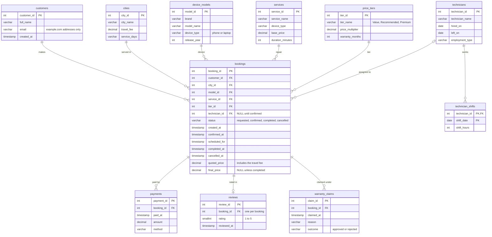

# Repair shop SQL

Ten business questions about a doorstep phone and laptop repair business, each answered with one SQL query on DuckDB.

[](https://github.com/analystkumar29/repair-shop-sql/actions/workflows/ci.yml)

I run [The Travelling Technicians](https://www.travelling-technicians.ca/), a doorstep phone and laptop repair service in Metro Vancouver. Running it means keeping track of bookings, technician schedules, payments, reviews and warranty claims, and asking questions like "which areas wait longest for a slot?" or "do cheaper parts come back more often?". This repo is the SQL I'd use to answer them.

The business's real data is private, so everything here runs on a **synthetic dataset**, modelled on the kind of data my repair business tracks, with no real customer data. [`generate_data.py`](generate_data.py) builds it from a fixed seed, so every run produces exactly the same files. Customer names are random pairings of common first and last names, every email is an `@example.com` address, and the prices are illustrative.

> **The numbers in this repo are not real business results.** They show what each query does, not how my business performs.

## What's in here

| Path | What it is |
|---|---|
| [`generate_data.py`](generate_data.py) | Builds the synthetic CSVs in `data/` (seeded and reproducible) |
| [`schema.sql`](schema.sql) | Table definitions: types, primary and foreign keys, `CHECK` constraints |
| [`sql/`](sql/) | The ten queries, one business question each |
| [`run_queries.py`](run_queries.py) | Loads the CSVs into DuckDB, runs every query and writes `results/` |
| [`results/`](results/) | Each query's output as a markdown table |
| [`tests/`](tests/) | pytest: data invariants, reproducibility and a sanity check on every answer |

## The data

About 4,400 bookings from May 2025 to the end of October 2026, across 12 service areas in the Lower Mainland. The generator simulates the patterns I'd expect to see in the real thing:

- **Growth and seasons.** Demand grows about 3% a month, peaks in summer and over the holidays, and dips in February.
- **Weekdays.** Monday gets the most new requests (phones broken over the weekend).
- **Capacity.** Each technician works set days with up to four appointment slots per shift. When the slots fill up, customers get the next free one, so busy months mean longer waits.
- **Route days.** Langley, Maple Ridge and Abbotsford are only visited on certain weekdays, so customers there wait longer.
- **Three price tiers.** Value, Recommended and Premium come with 3, 6 and 12 months of warranty. Cheaper parts fail more often, so Value jobs come back under warranty more.
- **Real-world mess.** About 8% of requests are never confirmed, longer waits lead to more cancellations, some prices change on the day, and some customers come back months later.
- **Two planted data problems** for the data-quality query to find: returning customers who registered again (same email, different capital letters), and cash jobs that were never entered as payments.

The data is a snapshot taken at 23:59 on 31 October 2026, so the newest bookings are still open, as they would be in a real export.



| Table | Rows | One row per |
|---|---:|---|
| `bookings` | 4,395 | repair request, with its milestones (created, confirmed, scheduled, then completed or cancelled) and its prices |
| `customers` | 3,794 | customer record |
| `payments` | 3,595 | payment for a completed job |
| `reviews` | 1,233 | review of a completed job (1 to 5 stars) |
| `warranty_claims` | 201 | warranty claim on a completed job |
| `technician_shifts` | 1,381 | day a technician worked |
| `cities` | 12 | service area, with its travel fee and the days we visit |
| `device_models` | 19 | phone or laptop model |
| `services` | 8 | type of repair for a phone or a laptop, with its base price and typical duration |
| `price_tiers` | 3 | price tier: Value, Recommended or Premium |
| `technicians` | 6 | technician (the names are made up too) |

The CSVs come to about 1 MB, so they're committed in [`data/`](data/). CI regenerates them on every push and fails if they don't match the committed files.

## The ten questions

| # | Business question | SQL techniques | Query | Result |
|---|---|---|---|---|
| 01 | How much did we earn each month, how did that compare with the month before, and what's the running total? | `LAG`, running `SUM() OVER`, `NULLIF` | [SQL](sql/01_monthly_revenue.sql) | [result](results/01_monthly_revenue.md) |
| 02 | Which repairs bring in the most money, and how does each one split across the price tiers? | conditional aggregation (pivot), `SUM(SUM(...)) OVER ()` | [SQL](sql/02_revenue_by_service_and_tier.sql) | [result](results/02_revenue_by_service_and_tier.md) |
| 03 | Which device models do we repair most in each city? | `RANK() OVER (PARTITION BY ...)`, window totals | [SQL](sql/03_top_models_per_city.sql) | [result](results/03_top_models_per_city.md) |
| 04 | Of each month's requests, how many were confirmed and how many completed? | `COUNT(column)` on milestone timestamps, conversion rates | [SQL](sql/04_booking_funnel.sql) | [result](results/04_booking_funnel.md) |
| 05 | What share of customers come back for another repair, and how soon? | monthly cohorts, `LEFT JOIN`, NULL for windows not yet observed | [SQL](sql/05_customer_retention.sql) | [result](results/05_customer_retention.md) |
| 06 | How many jobs does each technician do per working day, and how much of the shift is repair work? | `LEFT JOIN` from shifts, conditions in `ON`, two-step aggregation | [SQL](sql/06_technician_utilisation.sql) | [result](results/06_technician_utilisation.md) |
| 07 | How long do customers wait for an appointment in each area? | `PERCENTILE_CONT ... WITHIN GROUP`, interval arithmetic | [SQL](sql/07_lead_time_by_city.sql) | [result](results/07_lead_time_by_city.md) |
| 08 | Do cheaper tiers come back under warranty more often? | a fixed observation window, `LEFT JOIN`, `DISTINCT` | [SQL](sql/08_warranty_claims_by_tier.sql) | [result](results/08_warranty_claims_by_tier.md) |
| 09 | Which technicians get the best reviews, counting only those with 30 or more? | `GROUP BY ... HAVING`, `RANK()` over an aggregate | [SQL](sql/09_technician_ratings.sql) | [result](results/09_technician_ratings.md) |
| 10 | Can the numbers in the other nine be trusted? | `UNION ALL` of checks, `NOT EXISTS` anti-joins, counting duplicates | [SQL](sql/10_data_quality_checks.sql) | [result](results/10_data_quality_checks.md) |

Every query file starts with a comment block giving the business question, the techniques it uses and any caveats.

## Four queries up close

### Monthly revenue with month-over-month change ([01](sql/01_monthly_revenue.sql))

```sql
WITH completed_jobs AS (
    SELECT
        CAST(date_trunc('month', completed_at) AS DATE) AS month,
        final_price
    FROM bookings
    WHERE status = 'completed'
),

monthly AS (
    SELECT
        month,
        COUNT(*)         AS jobs,
        SUM(final_price) AS revenue
    FROM completed_jobs
    GROUP BY month
),

with_previous AS (
    SELECT
        month,
        jobs,
        revenue,
        LAG(revenue) OVER (ORDER BY month) AS previous_revenue  -- NULL for the first month
    FROM monthly
)

SELECT
    month,
    jobs,
    revenue,
    previous_revenue,
    ROUND(100.0 * (revenue - previous_revenue) / NULLIF(previous_revenue, 0), 1) AS mom_change_pct,
    SUM(revenue) OVER (
        PARTITION BY EXTRACT(YEAR FROM month)  -- restart the total each January
        ORDER BY month
        ROWS BETWEEN UNBOUNDED PRECEDING AND CURRENT ROW
    ) AS year_to_date_revenue,
    SUM(revenue) OVER (
        ORDER BY month
        ROWS BETWEEN UNBOUNDED PRECEDING AND CURRENT ROW
    ) AS running_total_revenue
FROM with_previous
ORDER BY month;
```

**How it works**

- The first two CTEs put each completed job in its month and add up the jobs and revenue.
- `LAG(revenue) OVER (ORDER BY month)` reads the revenue from the row before, so the change is a plain subtraction. The first month has no row before it, so its change is NULL. `NULLIF` turns a zero into NULL, so a month with no revenue can't cause a divide-by-zero.
- Both running totals are `SUM() OVER` with a frame from the first row up to the current one. `PARTITION BY` year restarts the year-to-date total each January; the other total never restarts.

### Top three device models in each city ([03](sql/03_top_models_per_city.sql))

```sql
WITH jobs_by_city_and_model AS (
    SELECT
        c.city_name,
        m.model_name,
        COUNT(*) AS jobs
    FROM bookings AS b
    JOIN cities AS c        ON c.city_id = b.city_id
    JOIN device_models AS m ON m.model_id = b.model_id
    WHERE b.status = 'completed'
    GROUP BY c.city_name, m.model_name
),

ranked AS (
    SELECT
        city_name,
        model_name,
        jobs,
        SUM(jobs) OVER (PARTITION BY city_name)                    AS city_jobs,
        RANK()    OVER (PARTITION BY city_name ORDER BY jobs DESC) AS rank_in_city
    FROM jobs_by_city_and_model
)

SELECT
    city_name,
    rank_in_city,
    model_name,
    jobs,
    ROUND(100.0 * jobs / city_jobs, 1) AS share_of_city_jobs_pct
FROM ranked
WHERE rank_in_city <= 3
ORDER BY city_jobs DESC, city_name, rank_in_city, model_name;
```

**How it works**

- `PARTITION BY city_name` makes both window functions work on each city separately: `SUM(jobs)` gives the city's total and `RANK()` numbers its models from most to fewest jobs.
- The rank can't be filtered in the same `SELECT`, because `WHERE` runs before window functions are calculated. So the ranking happens in a CTE and the outer query keeps `rank_in_city <= 3`.
- I used `RANK()` rather than `ROW_NUMBER()` on purpose: when two models tie, both stay in. In the committed results New Westminster has a tie for first place, so its ranks go 1, 1, 3.

### Cohort retention without the young-cohort trap ([05](sql/05_customer_retention.sql))

The last two steps of the query; the CTEs before them find each customer's first and second completed repair.

```sql
customer_history AS (
    SELECT
        CAST(date_trunc('month', f.first_date) AS DATE) AS cohort_month,
        s.second_date - f.first_date                    AS days_to_return,  -- NULL if never returned
        d.last_date - f.first_date                      AS days_observed
    FROM first_job AS f
    LEFT JOIN second_job AS s ON s.customer_id = f.customer_id
    CROSS JOIN data_end AS d
)

SELECT
    cohort_month,
    COUNT(*)                                           AS new_customers,
    ROUND(100.0 * COUNT(days_to_return) / COUNT(*), 1) AS returned_so_far_pct,
    CASE WHEN MIN(days_observed) >= 90 THEN
        ROUND(100.0 * COUNT(CASE WHEN days_to_return <= 90 THEN 1 END) / COUNT(*), 1)
    END                                                AS back_within_90_days_pct,
    -- ... the same again for 180 and 365 days
FROM customer_history
GROUP BY cohort_month
ORDER BY cohort_month;
```

**How it works**

- A customer's cohort is the month of their first completed repair. The `LEFT JOIN` keeps customers who never came back; for them `days_to_return` is NULL.
- `COUNT(days_to_return)` only counts the customers who returned, because `COUNT(column)` skips NULLs. That gives the repeat rate in one line.
- The trap is that a customer who first came in last month hasn't had time to come back, so young cohorts always look worse. `MIN(days_observed) >= 90` checks that *every* customer in the cohort has had at least 90 days, and the `CASE` returns NULL until they have. That's why the result has a triangle of NULLs in its bottom-right corner, the same shape as a classic cohort chart.

### Warranty claims by tier, compared fairly ([08](sql/08_warranty_claims_by_tier.sql))

```sql
WITH data_end AS (
    SELECT MAX(created_at) AS as_of
    FROM bookings
),

eligible_jobs AS (
    SELECT b.booking_id, b.tier_id, b.completed_at, b.final_price
    FROM bookings AS b
    CROSS JOIN data_end AS d
    WHERE b.status = 'completed'
      AND b.completed_at <= d.as_of - INTERVAL '90 days'
),

claimed_within_90_days AS (
    SELECT DISTINCT j.booking_id  -- a job with two claims still counts once
    FROM eligible_jobs AS j
    JOIN warranty_claims AS w ON w.booking_id = j.booking_id
    WHERE w.claimed_at <= j.completed_at + INTERVAL '90 days'
)

SELECT
    t.tier_name,
    t.warranty_months,
    COUNT(*)                                         AS jobs,
    ROUND(AVG(j.final_price), 2)                     AS avg_price,
    COUNT(c.booking_id)                              AS jobs_with_a_claim,
    ROUND(100.0 * COUNT(c.booking_id) / COUNT(*), 1) AS claim_rate_pct
FROM eligible_jobs AS j
JOIN price_tiers AS t ON t.tier_id = j.tier_id
LEFT JOIN claimed_within_90_days AS c ON c.booking_id = j.booking_id
GROUP BY t.tier_id, t.tier_name, t.warranty_months
ORDER BY t.tier_id;
```

On the synthetic data, where cheaper parts were made to fail more often, it gives:

| tier_name | warranty_months | jobs | avg_price | jobs_with_a_claim | claim_rate_pct |
|---|---:|---:|---:|---:|---:|
| Value | 3 | 665 | 133.87 | 75 | 11.3 |
| Recommended | 6 | 1420 | 163.51 | 71 | 5.0 |
| Premium | 12 | 736 | 216.09 | 22 | 3.0 |

**How it works**

- The tiers have different warranty lengths, so "all claims divided by all jobs" would compare a 3-month window with a 12-month one. Instead, every job gets the same 90-day window.
- `eligible_jobs` keeps only jobs completed at least 90 days before the data ends, so every job counted has had its full 90 days.
- `DISTINCT` stops a job with two claims from counting twice. The `LEFT JOIN` keeps jobs with no claim, so `COUNT(*)` counts every job while `COUNT(c.booking_id)` counts only the ones with a claim.

The data-quality query ([10](sql/10_data_quality_checks.sql)) is worth a look too. It stacks eight independent checks with `UNION ALL`; six pass, and the other two find the problems the generator planted.

## How to run it

You need Python 3.12 or newer.

```bash
python -m venv .venv
source .venv/bin/activate        # on Windows: .venv\Scripts\activate
pip install -r requirements.txt

python generate_data.py          # writes data/*.csv (recreates the committed files exactly)
python run_queries.py            # builds repair_shop.duckdb and writes results/*.md
pytest                           # checks the data and every query
```

`run_queries.py` leaves the database in `repair_shop.duckdb`, so you can explore it yourself with the [DuckDB CLI](https://duckdb.org/docs/installation/) (`duckdb repair_shop.duckdb`) or from Python. `python generate_data.py --seed 7 --out /tmp/other-data` makes a different but equally consistent dataset.

What the tests check:

- **The generator:** the same seed writes byte-identical files; no job is completed before it was requested; every completed job has a final price above zero; each booking's status matches its timestamps; every foreign key resolves; nothing is dated after the snapshot.
- **The queries:** all ten run and return rows, and their answers add up. For example, the funnel's outcomes add up to its requests, the running total ends at total revenue, the cohorts count every customer exactly once, and only technicians with 30 or more reviews are ranked.

## Design choices

- **DuckDB** runs inside Python, so there's no server to set up, and it loads CSVs directly; the whole project runs in seconds. The SQL sticks to standard features: as a one-off check, the same `schema.sql`, CSVs and all ten queries were run unchanged on PostgreSQL 16 and returned the same results.
- **The schema checks what a single row can prove; query 10 checks the rest.** `schema.sql` enforces types, keys and allowed values. Rules that need other rows or tables, like "every completed job has a payment", belong in the data-quality query.
- **The data stops mid-stream, and the queries say so.** The funnel shows bookings that are still open, the cohort table shows NULL for windows it hasn't seen yet, and the warranty query only uses jobs old enough to judge.

## What I'd do next

- Add PostgreSQL to CI with a service container, so "runs unchanged on PostgreSQL" is tested on every push rather than checked once by hand.
- Build a small dashboard on top of these queries (monthly revenue, the funnel and lead times) with filters for city and tier.
- Move the queries into dbt models with tests, so clean-up steps like merging duplicate customers happen once, before any report reads the data.
- Record how each customer found us, and break retention down by that channel.

---

More of my work: **[manojkumar-ca.vercel.app](https://manojkumar-ca.vercel.app)**

Licensed under the [MIT License](LICENSE).
